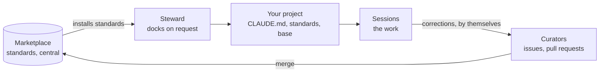

# personal-claude-plugin-marketplace

A company's standards for working with Claude Code, kept in one place and reused in
every project: how code is written and reviewed, which templates to use, what good
prose looks like. Each standard is a skill. The steward docks a project onto them when
someone asks, and the corrections people make flow back to the curators by themselves.

Everything here is prose: standards written once, in plain language an LLM can follow.
There is nothing to build. And nothing in it assumes the work is code: a skill can be
about a report or a template as much as about a codebase, even though every skill here
is about code today.

## How it fits together



- **Dock.** When you ask, the steward reads your project, writes a short `CLAUDE.md`,
  and installs the standards it shows a need for, with the base plugin.
- **Work.** You work as before. Each session knows every standard and offers the one
  that fits, the build and the tests stay green, and a review runs when you ask. Plan
  mode plans on Opus; the rest runs on Sonnet.
- **Grow.** When you correct Claude, the correction goes to the curators as an issue.
  A change they merge reaches every docked project by itself.

[The idea](docs/explanation/the-idea.md) explains why it is built this way.

## Five minutes

```bash
claude plugin marketplace add colla69/personal-claude-plugin-marketplace
claude plugin install marketplace-steward@personal-claude-plugin-marketplace --scope user
```

That is all a machine needs. Start a new session in a project and say "dock this
project". The steward asks once which marketplaces the project may draw from, and in a
project with code whether it writes Conventional Commits. It does the rest, and reports
every file it wrote. It never touches git in your project, so branch first.

The plugins are written and not yet tried on real projects. For a guided first run on a
small sample project, follow [your first docking](docs/tutorials/first-setup.md).

## What's inside

Every standard sits in one of four layers, from general to specific, and each plugin's
name starts with its layer. A fifth, Team, holds one team's quirks, as a last resort:

| Layer | Holds | Today |
|---|---|---|
| **Universal** | What holds for everything | Clean code, and the discipline of working where someone else maintains |
| **Craft** | How a kind of work is done | Developing, reviewing, unit testing, refactoring |
| **Language** | What the work is written in | Java, TypeScript, simple English |
| **Framework & Tools** | One concrete product | Vue, Pinia |
| **The marketplace's own** | Docks projects, runs in them, and grows the marketplace | `marketplace-steward`, `marketplace-base`, `marketplace-curator` |

[Plugins](docs/reference/plugins.md) lists each one with its skill, what it is for, when
it is installed and what it builds on.

## Documentation

| You want to | Read |
|---|---|
| Try it on a sample project | [Your first docking](docs/tutorials/first-setup.md) |
| Dock one of your projects, and work in it | [The guides](docs/README.md#guides) |
| Work lessons into the marketplace, as a curator | [Contribute a lesson](docs/guides/contribute-a-lesson.md) |
| Look something up | [The reference](docs/README.md#reference) |
| Fix something that went wrong without saying so | [Troubleshoot](docs/guides/troubleshoot.md) |
| Understand why it works this way | [The explanation pages](docs/README.md#explanation) |
| Work on the marketplace itself | [Contributing](CONTRIBUTING.md) |

Every page is on the map, [`docs/README.md`](docs/README.md).

## License

Apache License 2.0. See [LICENSE](LICENSE).
