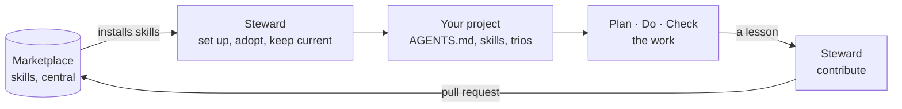

# personal-claude-plugin-marketplace

A library of skills for agentic work, kept in one place and reused in every project.
The skills hold the knowledge; the agents that use them are made in each project, from
that project's own facts, by the steward.

Everything here is prose: standards written once, in plain language an LLM can follow.
There is nothing to build. And nothing in it assumes the work is code: a skill can be
about a report or a template as much as about a codebase, even though every skill here
is about code today.

## How it fits together



- **Dock on.** The steward reads your project, writes its `AGENTS.md`, installs the
  skills it shows a need for, and creates a trio for each kind of task it repeats.
- **Work.** A trio runs a task in three steps: Plan proposes and waits for your OK, Do
  carries out the plan you accepted, and Check compares the result with it.
- **Grow.** What a project teaches goes back into the skills, by a pull request you
  merge, so the next project starts with it.

[The idea](docs/explanation/the-idea.md) explains why it is built this way.

## Five minutes

```bash
claude plugin marketplace add colla69/personal-claude-plugin-marketplace
claude plugin install marketplace-steward@personal-claude-plugin-marketplace --scope user
```

That is all a machine needs. Start a new session in a project and say "set this project
up". The steward asks once which marketplaces the project may draw from, does the rest,
and reports every file it wrote. It never touches git in your project, so branch first.

The steward is written and not yet tried on real projects. For a guided first run on a
small sample project, follow [your first setup](docs/tutorials/first-setup.md).

## What's inside

Every skill sits in one of four layers, from general to specific:

| Layer | Plugins |
|---|---|
| **Universal**: holds for everything | `universal-clean-code`, `universal-work-discipline` |
| **Craft**: how a kind of work is done | `craft-development`, `craft-review`, `craft-code-review`, `craft-unit-testing`, `craft-refactoring` |
| **Language**: what the work is written in | `language-java`, `language-typescript` |
| **Framework & Tools**: one concrete product | `tools-vue`, `tools-vue-typescript`, `tools-pinia` |
| **The steward**: sets projects up and grows the marketplace | `marketplace-steward` |

[Plugins](docs/reference/plugins.md) lists each one with its skill, what it is for, when
it is installed and what it builds on.

## Documentation

| You want to | Read |
|---|---|
| Try it on a sample project | [Your first setup](docs/tutorials/first-setup.md) |
| Set up, adopt, or update one of your projects | [The guides](docs/README.md#guides) |
| Give a lesson back to the marketplace | [Contribute a lesson](docs/guides/contribute-a-lesson.md) |
| Look something up | [The reference](docs/README.md#reference) |
| Understand why it works this way | [The explanation pages](docs/README.md#explanation) |
| Work on the marketplace itself | [Contributing](CONTRIBUTING.md) |

Every page is on the map, [`docs/README.md`](docs/README.md).

## License

Apache License 2.0. See [LICENSE](LICENSE).
