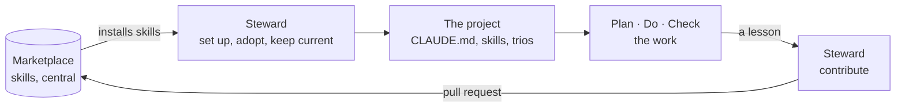

# The idea

Why this marketplace keeps its knowledge in one place and its workers in each project,
and why it isn't only for code. Read this before deciding whether the approach fits
your team. The quotes are the author's own words, from the sessions and the presentation
the idea was developed in.

## The problem

LLMs are in use everywhere, but each person uses them alone. "Some teams don't do it
collectively, every developer does his own thing." That has three costs:

| Cost | What it looks like |
|---|---|
| Fear of missing out | People are afraid of falling behind |
| Discrepancies | Everyone prompts differently and gets different quality |
| Lost know-how | What one person learned about getting good output stays in their head and their chat history |

It also creates a trust problem that cuts both ways. With too much trust, people accept
output as it comes, and quality drops. With too little, they redo the work, and the
rework costs time and credits. The gap to close is to raise the quality of the output
**without** costing performance: neither time nor tokens.

The diagnosis behind this marketplace: "we are using intelligence from the wrong point
of view. It is not a tool, it is a tooling fabric." What is missing is knowledge and
know-how, kept in one place, that the LLM can use. A tool gets replaced; the knowledge
stays.

## Knowledge central, workers local

> "The agents stay in repo, only the skills are in the marketplace and get worked on.
> That is the part where the knowledge is stored anyway."

That one sentence decides the shape of everything else.

| | Lives in | Changes by | Belongs to |
|---|---|---|---|
| **Knowledge**: skills | The marketplace | Being curated once and improved for everyone | Everyone who installs it |
| **Workers**: agents | Each project | Being generated for that project and its tasks | The project |
| **Project facts**: `CLAUDE.md` | Each project | Being written from the project itself | The project |

Four things follow:

1. **The marketplace holds knowledge only.** It is a library of skills, not a collection
   of ready-made workers. A worker shipped centrally would compete with the ones a
   project needs, and carry a second copy of the knowledge.
2. **One skill per plugin.** A plugin is what you install, so one plugin is one piece of
   knowledge you choose to have or not.
3. **Agents are made, not shipped.** The steward creates the agents a project needs, in
   that project, wired to the skills it installed. See
   [the steward](the-steward.md) and [skills and roles](skills-and-roles.md).
4. **Knowledge flows back.** What a project teaches goes back into the marketplace, so
   the next project starts with it.

## The cycle

**Dock on, work, grow.** The steward sets a project up from the marketplace. The
project's trios do the work. What the work teaches goes back through the steward, as a
pull request the maintainer merges, and from then on every project has it. "What one
person learns benefits everyone": what one team learns lands in the library, and the
next team has it on its first day.

## Modular, not uniform

"Central" is easy to mistake for "the same everywhere". The answer is a lego knowledge
base, kept from becoming uniform in three ways:

- **Knowledge is cut into small bricks.** One skill holds one thing, in one of four
  [layers](layers.md).
- **A project installs only the bricks it shows a need for.** A Vue skill is noise in a
  Go service, so a Go service never gets it.
- **Every brick says when to yield.** The more specific layer wins over the general one,
  and the project's own convention wins over all of them.

## The product is prose

A skill is a standard written in plain language that an LLM can read. There is no
build, and the product's only code is one script the steward measures a setup's token
cost with. Nothing in it is a technical control: a model may follow a skill,
ignore it, or follow it partly. So the marketplace is judged by how well its standards
are written and cut, and its checks exist only for the mistakes that fail silently.

## Not only for code

"Just trust me on this, it's a deep concept. The structure we thought of works with
almost anything using an LLM." The running example is deliberately not technical: a
team's monthly report, produced as a digitally signed PDF.

| Layer | The monthly report's bricks |
|---|---|
| Universal | The company guidelines |
| Craft | Formatting the monthly report: what is relevant and what isn't |
| Language | The enterprise templates, and German |
| Framework & Tools | Excel, PDF, the digital signature |

Every skill here is about code today, but nothing in the structure assumes it. Names,
layers and descriptions are written so that a skill about a report fits as well as one
about a codebase.

## Developers stay developers

"Developing should still be done by developers. With the help of agentic engineering
they can work while watching the process from a new vantage point, while leaving the
tedious work to LLMs." The person stays in control at every point that matters: a trio
stops for their OK before any work, and every change to the marketplace waits for their
merge. [Safety](safety.md) lists each of those points.

## Not in scope

Data protection, and whether a team may use LLMs at all. The approach assumes both are
settled.
