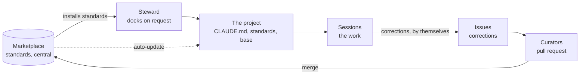

# The idea

Why this marketplace keeps a company's knowledge in one place, spreads it to every
project that asks, and learns from the corrections people make, and why it isn't only
for code. Read this before deciding whether the approach fits
your team. The quotes are the author's own words, from the sessions and the presentation
the idea was developed in.

## The problem

LLMs are in use everywhere, but each person uses them alone. "Some teams don't do it
collectively, every developer does his own thing." That has three costs:

| Cost | What it looks like |
|---|---|
| Fear of missing out | People are afraid of falling behind |
| Discrepancies | Everyone prompts differently and gets different quality |
| Lost know-how | What one person learned about getting good output stays in their head and their chat history |

It also creates a trust problem that cuts both ways. With too much trust, people accept
output as it comes, and quality drops. With too little, they redo the work, and the
rework costs time and credits. The gap to close is to raise the quality of the output
**without** costing performance: neither time nor tokens.

The diagnosis behind this marketplace: "we are using intelligence from the wrong point
of view. It is not a tool, it is a tooling fabric." What is missing is knowledge and
know-how, kept in one place, that the LLM can use. A tool gets replaced; the knowledge
stays.

## Knowledge central, quirks local

> "I am looking for a way to normalize and unify knowledge and centralize ways of
> working between teams."

A company's ways of working are standards: how code is annotated, a template, a quality
bar for prose, emails or presentations. Each is written once, as a skill, and every
project that needs it installs it.

| | Lives in | Changes by | Belongs to |
|---|---|---|---|
| **Standards**: skills | The marketplace | Being curated once and improved for everyone | Everyone who installs them |
| **Quirks and project facts**: `CLAUDE.md` | Each project | Being written from the project itself | The project |
| **A team's quirks**, shared by its projects | A `team-<name>` plugin, as a last resort | Being curated like a standard | The team |
| **Mechanics**: the index, the guard, the collector, a few helper agents | One base plugin | Being curated once | Every docked project |

Four things follow:

1. **One skill per plugin.** A plugin is what you install, so one plugin is one piece of
   knowledge you choose to have or not.
2. **Few workers, shipped once.** A project needs no agents of its own to apply a
   standard: the session reads the skill. The few helpers that pay for themselves, a
   test runner and a reviewer, ship in the base plugin. See [the base](the-base.md).
3. **Nobody has to ask.** People "just blurt into the editor", so every docked session
   starts with an index of every standard, and offers one when the work calls for it.
4. **Knowledge flows back by itself.** When a person corrects Claude, the correction
   goes to the curators as an issue, without anyone filing it.

## Three groups

| | Who | What they do |
|---|---|---|
| **Users** | Everyone who works in a docked project, beginners and experts | Their work. Anyone can talk to the steward; nobody has to |
| **Contributors** | Everyone, mostly without noticing | Correct Claude when it gets a way of working wrong. The correction reaches the curators |
| **Curators** | A few people who own the standards | Decide what a standard says, and merge the change |

## The cycle

**Dock, work, grow.** The steward docks a project onto the marketplace when someone
asks. The project's sessions do the work, with the standards and the base plugin. The
corrections people make reach the curators as issues, and a change they merge reaches
every docked project by itself. "What one person learns benefits everyone": what one
team learns lands in the library, and the next team has it on its first day.

## Modular, not uniform

"Central" is easy to mistake for "the same everywhere". The answer is a lego knowledge
base, kept from becoming uniform in three ways:

- **Knowledge is cut into small bricks.** One skill holds one thing, in one of four
  [layers](layers.md).
- **A project installs only the bricks it shows a need for.** A Vue skill is noise in a
  Go service, so a Go service never gets it.
- **Every brick says when to yield.** The more specific layer wins over the general one,
  and the project's own convention wins over all of them.

## The product is prose

A skill is a standard written in plain language that an LLM can read. There is no build,
and the product's only code is the script the steward measures a setup's token cost with
and the base plugin's hooks. A skill is not a technical control: a model may follow it,
ignore it, or follow it partly. The one thing the marketplace enforces is the one a hook
can check: in development, the build and the tests stay green. So the marketplace is
judged by how well its standards are written and cut, and its checks exist only for the
mistakes that fail silently.

## Not only for code

"Just trust me on this, it's a deep concept. The structure we thought of works with
almost anything using an LLM." The running example is deliberately not technical: a
team's monthly report, produced as a digitally signed PDF.

| Layer | The monthly report's bricks |
|---|---|
| Universal | The company guidelines |
| Craft | Formatting the monthly report: what is relevant and what isn't |
| Language | The enterprise templates, and German |
| Framework & Tools | Excel, PDF, the digital signature |

Every skill here is about code today, but nothing in the structure assumes it. Names,
layers and descriptions are written so that a skill about a report fits as well as one
about a codebase.

## Developers stay developers

"Developing should still be done by developers. With the help of agentic engineering
they can work while watching the process from a new vantage point, while leaving the
tedious work to LLMs." The person stays in control at every point that matters: a
project is docked only when they ask, the steward never commits, a review runs when they
ask for one, and every change to the marketplace waits for a curator's merge.
[Safety](safety.md) lists each of those points.

## Not in scope

Data protection, and whether a team may use LLMs at all. The approach assumes both are
settled.
